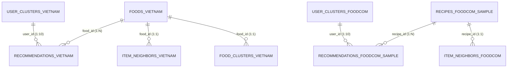

# HỢP ĐỒNG DỮ LIỆU GIAO TIẾP VỚI DASHBOARD STREAMLIT (DATA CONTRACT)

- **Phiên bản:** 1.0 (Giai đoạn P10 - Code & Data Freeze Ready)
- **Thư mục lưu trữ đích:** `app/data/`
- **Mục tiêu kỹ thuật:** Chuẩn hóa giao diện dữ liệu giữa pipeline xử lý phân tán Big Data (PySpark, Spark MLlib, HDFS) và ứng dụng người dùng cuối (Streamlit Dashboard).
- **Nguyên tắc cốt lõi:**
  1. **Độc lập cụm (Cluster Independence):** Toàn bộ ứng dụng Streamlit đọc dữ liệu từ `app/data/` thuần túy bằng thư viện **Pandas** và **PyArrow**, tuyệt đối **KHÔNG gọi Spark** khi chạy.
  2. **Tối ưu dung lượng (Compact Footprint):** Tổng dung lượng toàn bộ thư mục `app/data/` phải nhỏ hơn **100 MB** (thực tế đo được: **18.22 MB**).
  3. **Toàn vẹn quan hệ (Referential Integrity):** Khóa chính (Primary Key) và khóa ngoại (Foreign Key) giữa các tập gợi ý, hàng xóm tương đồng, phân cụm và danh mục món ăn khớp nhau 100%.
  4. **Bảo mật và Tinh gọn (Privacy & Cleanliness):** Đã loại bỏ hoàn toàn các trường văn bản bình luận tự do (review/comment text) và dữ liệu thô nhạy cảm.

---

## 1. Sơ đồ Quan hệ Thực thể và Luồng Dữ liệu (ERD)



---

## 2. Bảng Tổng hợp Danh mục Tệp Tin trong `app/data/`

| STT | Đường dẫn tương đối | Định dạng | Số dòng | Số cột | Dung lượng | Mục đích nghiệp vụ trên Dashboard |
|:---:|---|:---:|:---:|:---:|:---:|---|
| 1 | `foods_vietnam.parquet` | Parquet | 4,000 | 17 | 3.28 MB | Danh mục 4,000 món Việt: tên, calo, dinh dưỡng, thời gian nấu, nguyên liệu hiển thị. |
| 2 | `recipes_foodcom_sample.parquet`| Parquet | 78,171 | 15 | 10.27 MB | Danh mục 78,171 công thức Food.com sạch: calo, dinh dưỡng, nguyên liệu, tags. |
| 3 | `recommendations_vietnam.parquet`| Parquet | 1,010 | 7 | 19.25 KB | Top-10 gợi ý món ăn cho toàn bộ 101 user ViFoodRec (ALS Matrix Factorization). |
| 4 | `recommendations_foodcom_sample.parquet`| Parquet | 50,000 | 6 | 254.50 KB | Top-10 gợi ý món ăn cho mẫu 5,000 user Food.com (ALS Matrix Factorization). |
| 5 | `item_neighbors_vietnam.parquet`| Parquet | 4,000 | 3 | 311.79 KB | Ma trận Top-10 món tương đồng gần nhất (Item Latent Factor Cosine) cho 4,000 món Việt. |
| 6 | `item_neighbors_foodcom.parquet`| Parquet | 20,000 | 3 | 1.52 MB | Ma trận Top-10 món tương đồng cho Top 20,000 món phổ biến nhất của Food.com. |
| 7 | `user_clusters_vietnam.parquet`| Parquet | 101 | 3 | 3.12 KB | Nhãn phân cụm K-means cho 101 user ViFoodRec (3 cụm hành vi). |
| 8 | `user_clusters_foodcom.parquet`| Parquet | 30,772 | 3 | 194.69 KB | Nhãn phân cụm K-means cho 30,772 user Food.com (4 cụm hành vi). |
| 9 | `food_clusters_vietnam.parquet`| Parquet | 4,000 | 4 | 91.48 KB | Nhãn phân cụm dinh dưỡng K-means cho 4,000 món ăn ViFoodRec (4 cụm ẩm thực). |
| 10 | `cluster_profiles_food_vietnam.csv`| CSV | 4 | 11 | 0.88 KB | Bảng hồ sơ định lượng 3 cụm người dùng ViFoodRec so với trung bình hệ thống. |
| 11 | `cluster_profiles_food_com.csv`| CSV | 5 | 12 | 1.18 KB | Bảng hồ sơ định lượng 4 cụm người dùng Food.com so với trung bình hệ thống. |
| 12 | `food_cluster_profiles_vietnam.csv`| CSV | 5 | 11 | 0.92 KB | Bảng hồ sơ định lượng 4 cụm món ăn ViFoodRec (calo, đạm, béo, thời gian nấu). |
| 13 | `kmeans_tuning.csv` | CSV | 18 | 5 | 0.71 KB | Nhật ký dò tìm số cụm k tối ưu (Silhouette Score & WSSSE) cho cả 3 bài toán phân cụm. |
| 14 | `model_comparison.csv` | CSV | 8 | 7 | 0.54 KB | Bảng so sánh trực diện 3 mô hình Baseline và ALS MLlib trên tập Test của 2 bộ dữ liệu. |
| 15 | `als_tuning_food_vietnam.csv` | CSV | 24 | 7 | 1.01 KB | Toàn bộ 24 cấu hình Grid Search ALS cho ViFoodRec trên tập Validation. |
| 16 | `als_tuning_food_com.csv` | CSV | 8 | 7 | 0.35 KB | Toàn bộ 8 cấu hình Grid Search ALS cho Food.com trên tập Validation. |
| 17 | `scalability.csv` | CSV | 32 | 8 | 2.54 KB | Dữ liệu đo mở rộng quy mô (10%, 25%, 50%, 100% data $\times$ 1 Worker vs 2 Workers). |
| 18 | `storage_benchmark.csv` | CSV | 14 | 7 | 1.73 KB | Dữ liệu thực nghiệm đo lường hiệu quả nén và tốc độ truy vấn Parquet vs CSV. |
| 19 | `cleaning_log.csv` | CSV | 18 | 6 | 2.32 KB | Nhật ký chi tiết số dòng trước/sau qua từng bước làm sạch của cả 2 bộ dữ liệu. |
| 20 | `baseline_metrics.csv` | CSV | 6 | 7 | 0.40 KB | Các chỉ số đánh giá chi tiết của các mô hình Baseline (RMSE, MAE, P@10, R@10). |
| 21 | `baseline_rmse_breakdown.csv` | CSV | 42 | 4 | 1.57 KB | Phân rã sai số RMSE theo từng thang điểm thật (1 đến 5 sao) của Baseline. |
| 22 | `als_rmse_breakdown.csv` | CSV | 14 | 4 | 0.68 KB | Phân rã sai số RMSE theo từng thang điểm thật của mô hình ALS. |
| 23 | `eda_12_dataset_comparison.csv`| CSV | 7 | 3 | 0.29 KB | Bảng so sánh tổng quan đặc tính quy mô và độ thưa của Food.com vs ViFoodRec. |
| 24 | `eda/*.csv` (20 tệp) | CSV | — | — | ~16 KB | Toàn bộ 20 bảng tổng hợp khám phá dữ liệu (phân phối rating, thời gian, calo, v.v.). |

---

## 3. Đặc tả Chi tiết Schema Từng Tệp Tin Chính

### 3.1. `foods_vietnam.parquet` (Danh mục Món ăn ViFoodRec)
- **Đường dẫn:** `app/data/foods_vietnam.parquet`
- **Số dòng thực tế:** 4,000 dòng | **Số cột:** 17 cột | **Dung lượng:** 3.28 MB
- **Khóa chính:** `food_id` (duy nhất, không NULL)

| Tên cột | Kiểu dữ liệu | Nullable | Mô tả & Ý nghĩa nghiệp vụ | Ví dụ minh họa |
|---|:---:|:---:|---|---|
| `food_id` | `int32` | No | Định danh duy nhất của món ăn (0 đến 3,999) | `1248` |
| `dish_name` | `string` | No | Tên món ăn đã chuẩn hóa Unicode tiếng Việt | `"Chè Bí Đỏ Nước Cốt Dừa"` |
| `dish_type` | `string` | No | Phân loại ẩm thực: `"Món mặn"` hoặc `"Món chay"` | `"Món mặn"` |
| `calories` | `float32` | Yes | Năng lượng dinh dưỡng (kcal) | `239.0` |
| `fat` | `float32` | Yes | Lượng chất béo (g) | `9.4` |
| `fiber` | `float32` | Yes | Lượng chất xơ (g) | `3.2` |
| `sugar` | `float32` | Yes | Lượng đường (g) | `22.5` |
| `protein` | `float32` | Yes | Lượng đạm (g) | `4.1` |
| `cooking_time` | `string` | Yes | Chuỗi thời gian nấu gốc từ nguồn | `"45"` |
| `cooking_time_min` | `int32` | Yes | Thời gian nấu chuẩn hóa thành số phút (phục vụ thanh trượt lọc UI) | `45` |
| `serving_size` | `string` | Yes | Chuỗi khẩu phần gốc | `"4 người"` |
| `serving_size_num` | `int32` | Yes | Khẩu phần quy đổi thành số người | `4` |
| `ingredients` | `string` | Yes | Chuỗi danh sách nguyên liệu dùng để hiển thị trên UI | `"Bí đỏ, Nước cốt dừa, Đường thốt nốt"` |
| `dish_tags` | `string` | Yes | Các thẻ đặc trưng món ăn (nối chuỗi từ mảng) | `"Tráng miệng, Nấu nhanh, Miền Tây"` |
| `cooking_method` | `string` | Yes | Phương pháp chế biến chính | `"Nấu / Hầm"` |
| `image_link` | `string` | Yes | Đường dẫn URL ảnh minh họa món ăn | `"https://..."` |
| `description` | `string` | Yes | Mô tả tóm tắt cách chế biến món ăn | `"Món chè thanh mát béo ngậy..."` |

---

### 3.2. `recipes_foodcom_sample.parquet` (Danh mục Công thức Food.com)
- **Đường dẫn:** `app/data/recipes_foodcom_sample.parquet`
- **Số dòng thực tế:** 78,171 dòng | **Số cột:** 15 cột | **Dung lượng:** 10.27 MB
- **Khóa chính:** `recipe_id` (duy nhất, không NULL)

| Tên cột | Kiểu dữ liệu | Nullable | Mô tả & Ý nghĩa nghiệp vụ | Ví dụ minh họa |
|---|:---:|:---:|---|---|
| `recipe_id` | `int32` | No | Định danh duy nhất của công thức Food.com | `339814` |
| `name` | `string` | No | Tên món ăn tiếng Anh đã làm sạch | `"mom s corn pudding"` |
| `minutes` | `int32` | Yes | Thời gian nấu nguyên bản (phút) | `35` |
| `minutes_clean` | `float32` | Yes | Thời gian nấu đã lọc ngoại lai (>1440p gắn cờ NULL) | `35.0` |
| `n_steps` | `int32` | Yes | Số bước thực hiện nấu ăn | `7` |
| `n_ingredients` | `int32` | Yes | Số lượng nguyên liệu thành phần | `6` |
| `calories` | `float32` | Yes | Lượng calo tính toán (kcal) | `132.6` |
| `total_fat_pdv` | `float32` | Yes | % giá trị hàng ngày của tổng chất béo (PDV) | `8.0` |
| `sugar_pdv` | `float32` | Yes | % giá trị hàng ngày của đường | `24.0` |
| `sodium_pdv` | `float32` | Yes | % giá trị hàng ngày của natri | `12.0` |
| `protein_pdv` | `float32` | Yes | % giá trị hàng ngày của protein | `6.0` |
| `saturated_fat_pdv`| `float32` | Yes | % chất béo bão hòa | `10.0` |
| `carbohydrates_pdv`| `float32` | Yes | % carbohydrate | `18.0` |
| `ingredients` | `string` | Yes | Danh sách nguyên liệu hiển thị phân tách bằng dấu phẩy | `"corn, butter, milk, eggs, sugar"` |
| `tags` | `string` | Yes | Thẻ thể loại, dịp ăn uống, thời gian chế biến | `"60-minutes-or-less, side-dishes, oven"` |

---

### 3.3. `recommendations_vietnam.parquet` (Top-10 Gợi ý ViFoodRec)
- **Đường dẫn:** `app/data/recommendations_vietnam.parquet`
- **Số dòng thực tế:** 1,010 dòng (101 users $\times$ 10 món) | **Số cột:** 7 cột | **Dung lượng:** 19.25 KB
- **Khóa ngoại:** `user_id` $\rightarrow$ `user_clusters_vietnam.user_id`, `food_id` $\rightarrow$ `foods_vietnam.food_id`

| Tên cột | Kiểu dữ liệu | Nullable | Mô tả & Ý nghĩa nghiệp vụ | Ví dụ minh họa |
|---|:---:|:---:|---|---|
| `user_id` | `int32` | No | Mã định danh người dùng khảo sát (101 users) | `70` |
| `rank` | `int64` | No | Thứ hạng gợi ý từ 1 đến 10 theo mô hình ALS | `1` |
| `food_id` | `int32` | No | Mã món ăn được gợi ý | `1248` |
| `dish_name` | `string` | No | Tên món ăn gợi ý | `"Chè Bí Đỏ Nước Cốt Dừa"` |
| `dish_type` | `string` | No | Phân loại món (Mặn / Chay) phục vụ bộ lọc UI | `"Món mặn"` |
| `calories` | `float32` | Yes | Năng lượng dinh dưỡng của món (kcal) | `239.0` |
| `cooking_time` | `string` | Yes | Thời gian chế biến món (phút) | `"45"` |

---

### 3.4. `recommendations_foodcom_sample.parquet` (Top-10 Gợi ý Food.com Mẫu)
- **Đường dẫn:** `app/data/recommendations_foodcom_sample.parquet`
- **Số dòng thực tế:** 50,000 dòng (5,000 users $\times$ 10 món) | **Số cột:** 6 cột | **Dung lượng:** 254.50 KB
- **Khóa ngoại:** `user_id` $\rightarrow$ `user_clusters_foodcom.user_id`, `recipe_id` $\rightarrow$ `recipes_foodcom_sample.recipe_id`

| Tên cột | Kiểu dữ liệu | Nullable | Mô tả & Ý nghĩa nghiệp vụ | Ví dụ minh họa |
|---|:---:|:---:|---|---|
| `user_id` | `int32` | No | Mã định danh người dùng mẫu Food.com | `1676` |
| `rank` | `int64` | No | Thứ hạng gợi ý từ 1 đến 10 theo mô hình ALS | `1` |
| `recipe_id` | `int32` | No | Mã công thức được gợi ý | `339814` |
| `name` | `string` | No | Tên món ăn gợi ý | `"mom s corn pudding"` |
| `calories` | `float32` | Yes | Năng lượng (kcal) | `132.6` |
| `minutes_clean` | `float64` | Yes | Thời gian nấu (phút) | `35.0` |

---

### 3.5. `item_neighbors_vietnam.parquet` & `item_neighbors_foodcom.parquet` (Món Tương Đồng - Phục vụ Cold-Start)
- **Đường dẫn:** `app/data/item_neighbors_vietnam.parquet` (4,000 món) và `app/data/item_neighbors_foodcom.parquet` (20,000 món)
- **Mục tiêu:** Cung cấp ma trận độ tương đồng Cosine trích xuất từ Item Latent Factor Matrix ($V \in \mathbb{R}^{M \times r}$) của ALS để gợi ý món tương tự cho người dùng mới (Cold-Start Recommender).

| Tên cột | Kiểu dữ liệu | Nullable | Mô tả & Ý nghĩa nghiệp vụ | Ví dụ minh họa |
|---|:---:|:---:|---|---|
| `food_id` / `recipe_id` | `int64` | No | Mã món ăn gốc cần tìm kiếm món tương tự | `0` (hoặc `280`) |
| `neighbor_ids` | `list[int64]` | No | Mảng danh sách 10 mã món ăn có độ tương đồng cao nhất | `[1082, 3324, 3214, 2750, 438, ...]` |
| `similarity_scores` | `list[float64]` | No | Mảng 10 điểm tương đồng Cosine tương ứng ($\cos \in [0, 1]$) | `[0.9830, 0.9748, 0.9694, 0.9685, ...]` |

---

### 3.6. Các tệp Phân Cụm Hành Vi & Hồ Sơ (`user_clusters_*` & `food_clusters_*`)
1. **`user_clusters_vietnam.parquet` (101 dòng):**
   - `user_id` (`int32`): Mã người dùng.
   - `cluster` (`int32`): Cụm hành vi (0, 1, 2).
   - `cluster_name` (`string`): Tên tiếng Việt diễn giải cụm (ví dụ: *"Thực Khách Chuộng Bữa Nhanh"*, *"Thực Khách Tiết Chế & Khắt Khe"*, *"Thành Viên Đánh Giá Tích Cực"*).
2. **`user_clusters_foodcom.parquet` (30,772 dòng):**
   - `user_id` (`int32`), `cluster` (`int32`: 0 đến 3), `cluster_name` (`string`: *"Đánh giá Khắt khe"*, *"Phổ thông Dễ tính"*, *"Chuộng Món Nhanh Gọn"*, *"Thâm niên Tích cực"*).
3. **`food_clusters_vietnam.parquet` (4,000 dòng):**
   - `food_id` (`int32`), `dish_name` (`string`), `cluster` (`int32`: 0 đến 3), `cluster_name` (`string`: *"Món Mặn Chiên Xào Đậm Vị"*, *"Món Canh & Hầm Dinh Dưỡng"*, v.v.).

---

## 4. Kiểm Chứng Toàn Vẹn Tự Động (Verification Protocol)

Mọi tệp tin trong `app/data/` đều phải vượt qua bài kiểm chứng độc lập của công cụ:
```bash
python src/verify_export.py
```
*Kết quả kiểm thử chính thức ngày 14/10/2026:*
- **Tổng số tiêu chí:** 66/66 ĐẠT (100.0%).
- **Lỗi khóa ngoại:** 0 (Không có bất kỳ `food_id`, `recipe_id` hay `user_id` nào bị mồ côi).
- **Văn bản bình luận nhạy cảm:** 0 phát hiện.
- **Tổng dung lượng:** 18.22 MB $\ll$ 100 MB.

---
*Tài liệu Hợp đồng Dữ liệu được ban hành chính thức cho Giai đoạn P10 & P11.*
